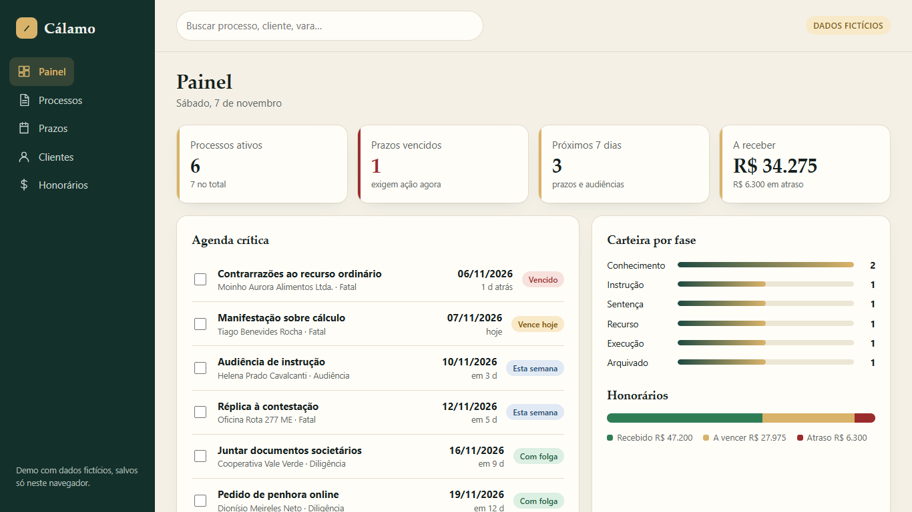
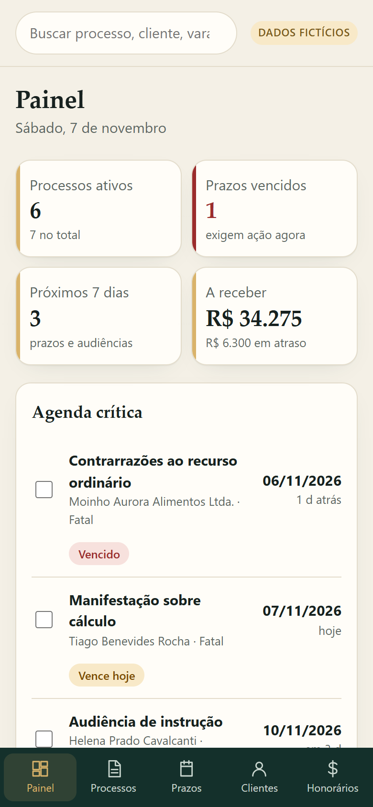

# Cálamo — legal practice CRM (demo)

A small, fast CRM for law firms: **cases, deadlines, clients and fees** in one place. Built with **SolidJS + TypeScript + Vite**.

**Live demo:** https://alissonlittig.github.io/calamo-juridico/

> All data is **fictional** and stored only in your browser (`localStorage`). Nothing is sent anywhere.

| Desktop | Mobile (390px) |
|---|---|
|  |  |

## Features
- **Dashboard** — active cases, overdue deadlines, next 7 days, receivables, pipeline by phase, fees bar.
- **Cases** — search, expandable detail, change phase, linked deadlines.
- **Deadlines & hearings** — urgency classification (overdue / today / this week / comfortable), tick off when done.
- **Clients** — individuals and companies with open fees per client.
- **Fees** — contractual and success fees, paid / due / overdue status, mark as paid.
- Create cases, clients, deadlines and fee entries; reset to sample data at any time.
- Responsive layout with bottom tab bar on phones; keyboard and screen-reader friendly.

## Run locally
```bash
npm install
npm run dev     # development
npm test        # unit tests (deadline urgency, fee totals)
npm run build   # type-check + production build
```

## Deploy
GitHub Actions (`.github/workflows/pages.yml`) runs tests, builds and publishes to GitHub Pages on every push to `main`.

## Notes
Sample dates are generated relative to today so the demo never looks stale. Case numbers, CPF/CNPJ and names are made up.
